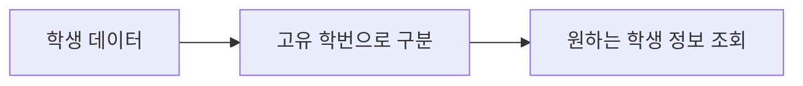

# B6-1 — 00단계, 데이터베이스를 쉽게 배우기

> **교육 개요: PLAN_ONLY** · **공식 요구 분석: NOT_STARTED** · **신규 코드: NOT_STARTED / 승인 PENDING** · **검증: NOT_VERIFIED**

**30초 요약:** 데이터베이스는 자료를 정리하고 다시 찾기 위한 도구입니다. 오늘은 **기본키(Primary Key)** 한 개념만 살펴봅니다.

## 00단계의 4개 학습 영역

| 경로 | 이동 |
|---|---|
| A. 처음 시작하기 | [시작](#b61-start) |
| B. 기술 배우기 | [첫 개념](#b61-learn) |
| C. 진행 확인하기 | [현황](#b61-status) |
| D. 상세 참고자료 | [더 읽기](#b61-more) |

## A. 처음 시작하기

이번 단계에서는 관계형 데이터의 기본 원리를 배우기 위한 계획을 준비합니다. 공식 요구사항 분석은 01단계에서 시작합니다.

**학습 시작:** 아래 첫 개념을 읽거나 [기술 개요](TECHNICAL-LEARNING-OUTLINE.md)를 확인하세요.

## B. 기술 배우기 — 오늘은 기본키 하나

**기본키(Primary Key)**는 테이블에서 각 행을 구별하는 값 또는 값의 조합입니다. 학생마다 고유한 학번을 부여하는 것과 비슷합니다.

**질문:** 서로 다른 두 행에 같은 기본키 값을 사용할 수 있을까요?

**답:** 기본키의 고유성 제약을 따르면 안 됩니다.
### 내 말로 설명·종이 재현 (Teach-back / Dry-run)

**두 문장으로 설명:** 기본키(Primary Key, PK)는 테이블의 각 행을 유일하게 식별합니다. 중복값과 NULL을 허용하지 않는 제약을 가집니다.

**종이에 실행 흐름을 그려보세요.**
1. **입력:** 학번이 있는 학생 데이터 두 행을 가정.
2. **처리:** 각 행의 기본키가 서로 다른지 확인.
3. **예상 결과:** 중복이라면 기본키 제약에 위배된다고 설명.

**흔한 오해:** 기본키는 자동으로 모든 데이터 품질을 보장하거나 다른 테이블의 참조 관계를 대신하지 않습니다.

<ins>교육용 가상 재현과 실제 신규 코드의 실행·테스트를 구분합니다.</ins> [한글·영어·약어 용어표](TECHNICAL-LEARNING-OUTLINE.md)를 더 읽어보세요.

이것은 **교육용 개념도**이며 구현된 신규 시스템의 설계·실행 결과가 아닙니다.

## C. 진행 확인하기

| 단계 | 상태 |
|---|---|
| 00 교육·계획 문서 | PLAN_ONLY |
| 01 공식 평가 분석 | NOT_STARTED |
| 03 실제 시스템 설계 | NOT_STARTED |
| 04 신규 코드 | NOT_STARTED / 승인 PENDING |
| 실제 테스트·학습자 평가 | NOT_VERIFIED |

## D. 상세 참고자료

[기술 개요](TECHNICAL-LEARNING-OUTLINE.md) · [학습체계](LEARNING-SYSTEM-PLAN.md) · [슬라이드 계획](SLIDE-PACKAGE-PLAN.md) · [01단계](../01-requirements/README.md) · [중앙 학습 표준](https://github.com/MetaStudy999/codyssey-basic/blob/main/standards/LEARNER-CENTERED-AI-LEARNING-STANDARD.md)

**원칙:** 한 번에 한 개념씩 학습합니다. 기존 Round 자료와 개발 승인 상태는 보존합니다.

---

## 기존 계획·승인 기록

**기존 제목:** B6-1 — 공식 요구·목차·승인

Round 04 Agent 전용 공간입니다. 현재 PLAN_ONLY: 승인 전 신규 구현·실행 없음. 이전 Round 자료 보존.

## 선행 단계

[01 공식 요구](../01-requirements/README.md) → [02 기존 분석](../02-analysis/README.md) → [03 신규 설계](../03-design/README.md). 계획 문서·승인 관리와 실제 구현·검증을 구분합니다.

## 4종 학습·발표 승인 (2026-10-26)

[계획](SLIDE-PACKAGE-PLAN.md): 발표 16장 · 학습 45장 · 심화 15~25장 · 복습 1~2장. **PLAN_ONLY**.

## 학습자 중심 AI 교육체계 승인 (2026-10-26)

[학습 통합 계획](LEARNING-SYSTEM-PLAN.md) · M01~M16, PRIMM, H1~H4, L1~L5, QG-01~08, 진단·회상 복습. 신규 구현·실제 학습 자료는 아직 미제작.

## 기술 학습 9요소 — 입문자용 개요 (2026-10-26)

[B6-1 기술 용어·개념·Mermaid 개념 아키텍처·주요 코드·실습·평가 안내](TECHNICAL-LEARNING-OUTLINE.md). **용어 → 개념 → 비유 → 아키텍처 → 주요 코드 → 실행 흐름 → 오류 해결 → 실습 → 평가**를 이번 미션 기술에 맞춰 적용합니다.

현재는 **PLAN_ONLY**이며 실제 신규 구현·실행·학습자 평가 **NOT_STARTED / NOT_VERIFIED**, 개발 승인 **PENDING**은 유지합니다.
